# CloakTix

Private event ticketing on Midnight Preview (ledger 9).

> **Status: prototype, not audited. Preview test network only. Do not use with real funds.**
> Built for the Midnight Buildathon (Wave 3, then door check-in in November 2026).

CloakTix sells event tickets on Midnight. Buyers pay in **NIGHT only**. Prices are shown in **USD**, with a **NIGHT equivalent** underneath. The wallet is **1AM**. Buyers buy with a zero-knowledge proof generated in the browser and show a QR at the door. Staff phones check tickets without a wallet. Organizers set the resale rules for each ticket type. For 18+ types, buyers prove only "adult: yes". They do not show an ID document.

Thanks to the Midnight developer community and the [midnightntwrk](https://github.com/midnightntwrk) open-source work this project builds on, including Compact contracts, Midnight.js, ZKIR v3, and the Midnight Verifiable Credentials core (`midnightntwrk/midnight-verifiable-credentials`).

## Live Preview contracts

- Network: Midnight **Preview**, ledger 9
- **EGG-40 contract (current, public):** `7f6481e3bec6b778db7b5959837ab82a5ffe47468f56aab4bfc4bdc56830d372`.
  Source: `contract/cloaktix-egg40.compact`. Events, ticket types, NIGHT fee split, signed USD quotes (up to 300 s old),
  resale, 18+ check, door keys, and door settlement in batches of 4.
- **Earlier rate-v3 contract (still live, one test event):** `b92733389b1955c913dec004df708a12697df4a962ffab5dbde1e88f574ab04e`.
  Source: `contract/cloaktix-rate-v3.compact`. The app still reads and sells on it.
- Platform fee: 3% (`feeBps` = 300), sealed at deploy, on both contracts
- App (public): https://app.cloaktix.com
- Door relay (public, no secrets): https://cloaktix-door-relay.peejay0786.workers.dev (source in `door-relay/`)
- Landing: https://cloaktix.com

The project owner deploys the contracts and signs every transaction in 1AM. This repository does not sign transactions.

## Launch Night demo

EGG-40 event 1 is **CloakTix Launch Night**: a General admission (18+) and an After party ticket type. Doors open
Dec 12, 2026, 19:00 to 23:00 (Toronto time). You can buy a ticket with 1AM on Preview, open it in My tickets, and
show its QR at Main door.

## Features

- **Walletless catalog.** Anyone can browse published events without a wallet. Event and ticket type names come from
  organizer-signed catalog metadata, and prices and supply from the chain. Buying needs a connected wallet.
- **Organizer event creation.** Name, date, place, description and cover are required. The organizer sets a NIGHT
  payout address at creation. It receives the event's payments and cannot be changed later.
- **NIGHT only.** USD list prices with a NIGHT equivalent at a signed quote. ADA is not offered.
- **Visible buy steps.** Checkout shows "Preparing your purchase", then "Building proof" with a timer, then
  "Approve in your wallet, then confirming on Midnight". Errors show in the dialog.
- **Multi-ticket purchase in a single intent.** Up to 4 tickets of one type. All `buyTicket` calls are merged into one
  intent in purchase order, so 1AM sees one NIGHT input set. All or nothing.
- **Demo 18+ age credential.** 18+ types use `buyTicketAdult`. A "Passport stub" test issuer, served by the Preview
  Worker at `/passport/issuer` and `/passport/issue`, signs a credential bound to the buyer's CloakTix identity. The
  contract checks the issuer signature and `adultFrom ≤ asOf` and learns only "adult: yes". This is a demo issuer, not
  Midnight Passport. A real issuer can be set later with one `adminSet` transaction.
- **My tickets.** Ticket cards with Show QR, Print and Send to phone. The QR is `cloaktix:admit:v2` (contract, serial,
  epoch and a secret kept in this browser). Its commitment is registered on-chain inside the purchase.
- **Send to phone.** A ticket opens on another phone from a link. The link travels in the URL fragment, which does
  not reach the server.
- **In-tab ZKIR v3 prover.** Compact 0.36.0 emits ZKIR v3. 1AM's built-in prover accepts v2, so CloakTix proves its own
  circuits in a tab worker (`zkir-v3` 3.2.0). 1AM still balances, pays DUST and submits.
- **Resale policy per ticket type:** `capped` (default, price ≤ `maxResale`, enforced on-chain), `unlimited`, or `none`.
- **Door check-in with staff phones** (EGG-40, see below).
- **Door-safe screens.** The app does not show wallet balances, because the phone may be shown at the door.

## Door check-in (EGG-40)

1. **Organizer sets doors** (for example Main door) and the door times in Organize event › Door keys.
2. **Staff phone, no wallet:** opens the door link (copied, or scanned from the "Show QR" code in Door keys), picks a door, and shows a pairing code. The phone keeps its own
   non-extractable signing key.
3. **Organizer approves** the phone after checking the fingerprint. This is one 1AM transaction (`authorizeDoorKey`)
   with a validity window of up to 48 h. The default runs from 1 h before doors until a day after they close. The
   dialog shows Building proof (with a timer), then Approve in your wallet.
4. **Scan:** the phone reads the ticket on-chain (indexer, through the app's same-origin proxy) and asks the relay to
   record the first entry. The entry is signed by the door key, and the ticket secret is encrypted to the organizer.
   Verdicts: Valid, Already used, Wrong door, Not for this event, Not valid (replaced copy), Door not open yet (key
   window not started, nothing recorded), This door key has expired, or Can't confirm entry (relay or indexer
   unreachable; the phone fails closed).
5. **Settlement:** after the event, the organizer's settlement key (gate 99) records the relay's entries on-chain in
   batches of 4 (`admitByDoor4`). Plan B: the organizer admits a guest directly with 1AM (`admit`).
6. **Revoke** a door key at any time (`revokeDoorKey`). Entries it already recorded still count.

The relay checks every write against the EGG-40 contract state read from the public indexer. Organizer routes need a
signature from the organizer key bound on-chain. It stores no secrets.

## Screenshots

### Door check-in (19 November 2026, live app)

Taken on the live Preview app during the first real door test of the Launch Night demo event.

| | |
|---|---|
| 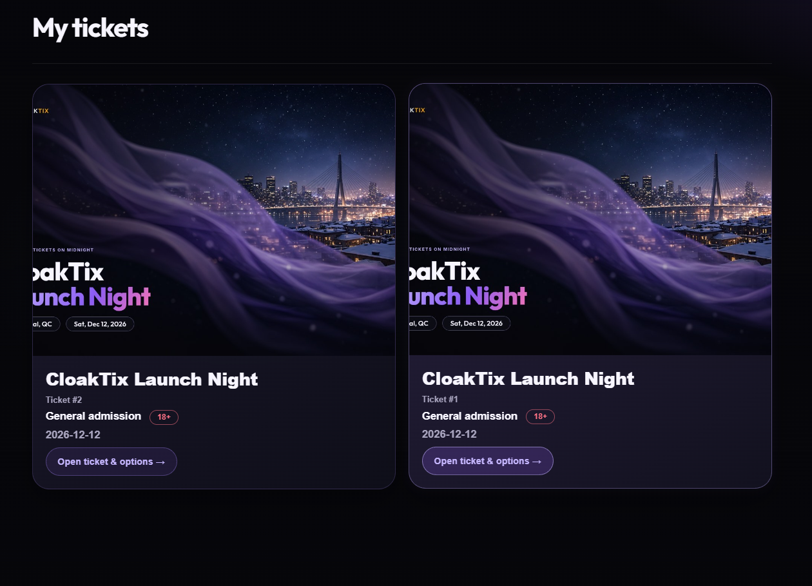 | 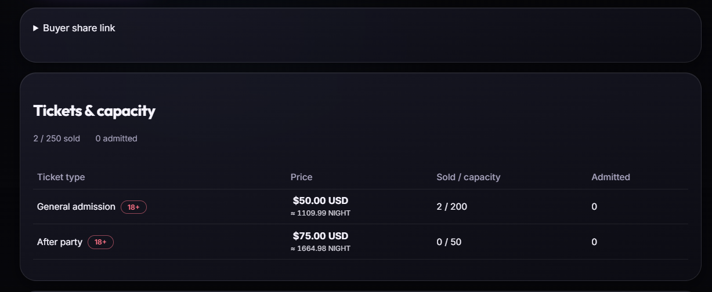 |
| My tickets: two General admission tickets for Launch Night. | Organizer view: sold and admitted per ticket type, USD price with NIGHT conversion. |
| 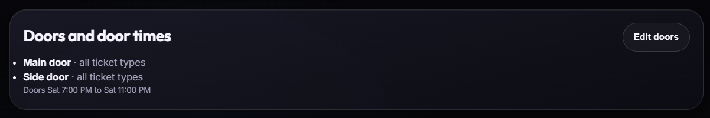 | 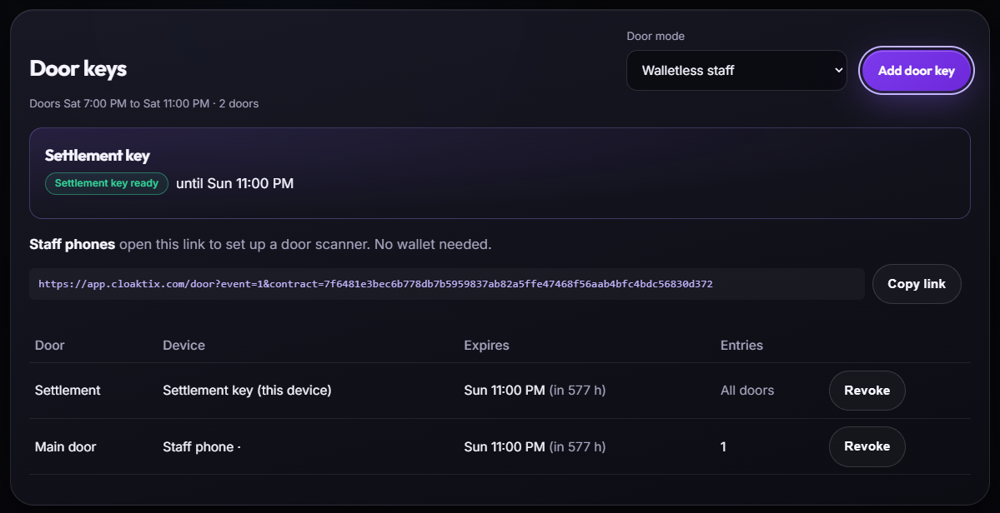 |
| Doors and door times stored on-chain. | Door keys: settlement key, staff phone link and per-door entry count. |
| 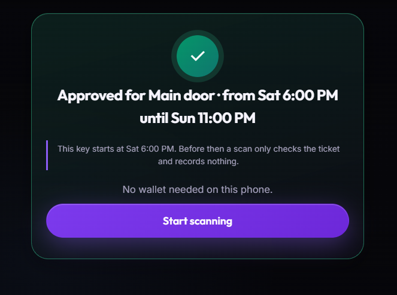 | 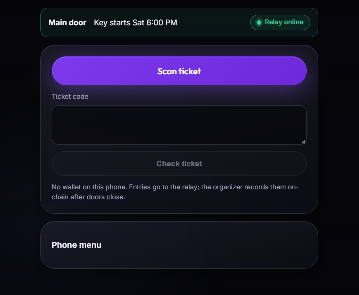 |
| Staff phone approved on-chain for Main door. No wallet on the phone. | Door scanner with relay status and key window. |
| 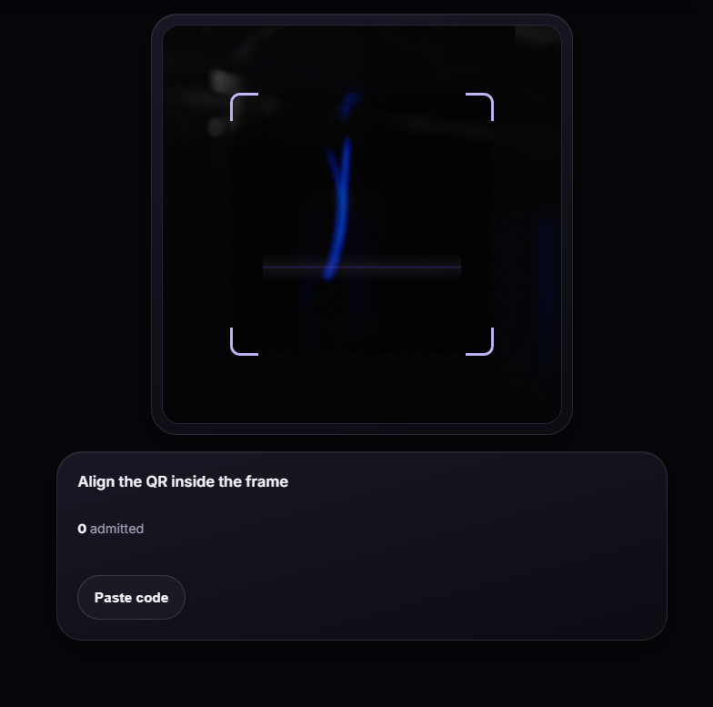 | 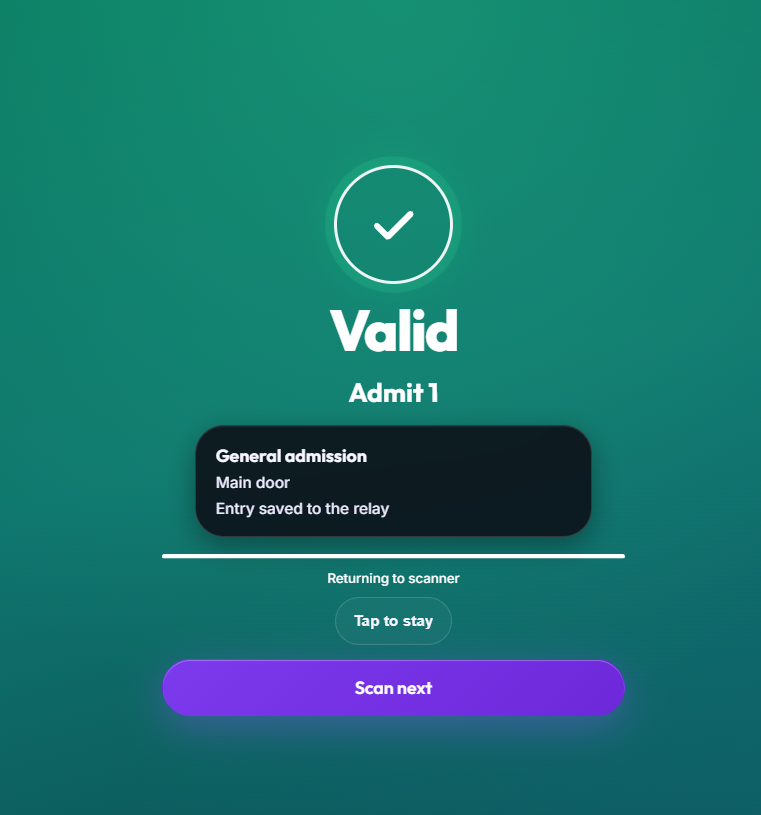 |
| Camera scan of the ticket QR. | Valid ticket: entry saved to the signed relay. A second scan shows Already used. |
| 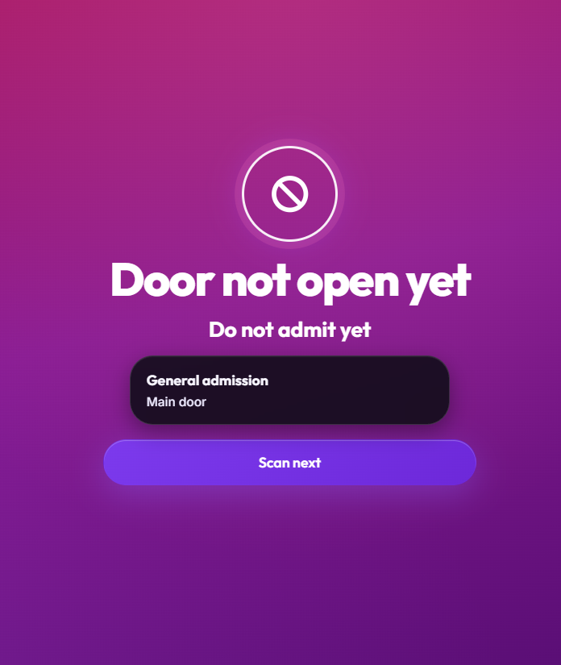 | |
| Before the key window opens, the ticket is checked but nothing is recorded. | |

### Wave 3 UI (10 November 2026)

Captured from the public Preview app on 10 November 2026, before door keys and the updated button colors.


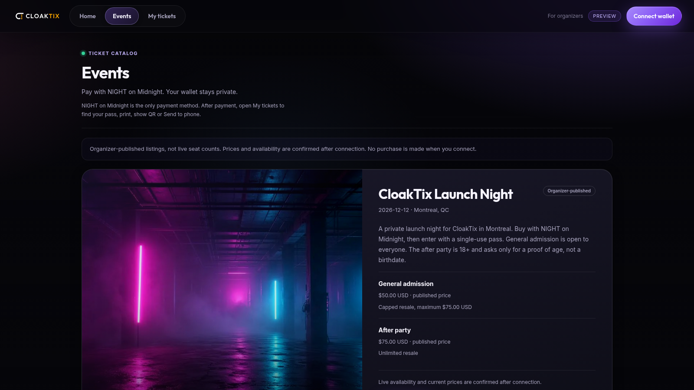

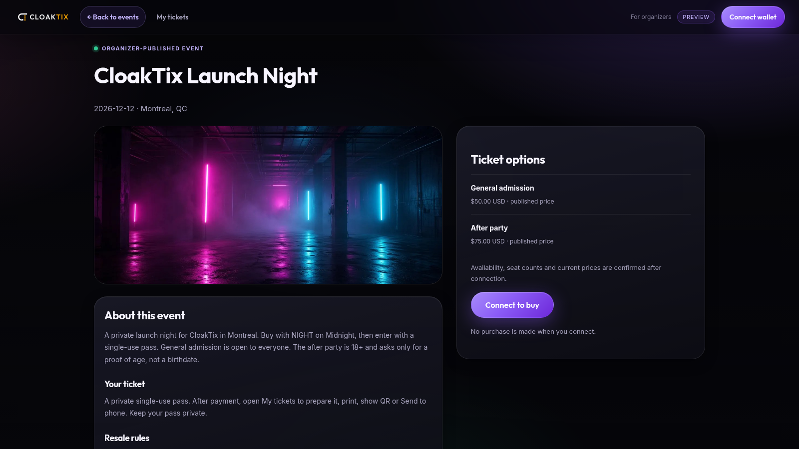


## Architecture

| Layer | What |
|---|---|
| Contract | `contract/cloaktix-egg40.compact` (live) and `contract/cloaktix-rate-v3.compact` (earlier, live), Compact 0.36.0, language 0.28.0. Compiled JS and ZKIR are in `contract/managed/` |
| Witnesses | `contract/witnesses-egg40.ts`, `contract/witnesses-rate-v3.ts`: holder secret and optional age credential, from local private state |
| Web app | `web/`: React and Vite, Midnight.js 5.0.0, compact-runtime 0.21.0, DApp Connector v4 (1AM), on-chain runtime v4, ZKIR v3. Door UI in `web/src/doorkeys/`, door logic in `web/src/egg40/` |
| Preview Worker | `preview-worker/`: serves the app, the public catalog, same-origin ZK assets and indexer proxy, and the demo Passport stub issuer |
| Door relay | `door-relay/`: Cloudflare Worker, one Durable Object per event. Door logic is shared with `web/src/egg40/eventDoor.ts` |
| Rate signer | Signs USD→NIGHT quotes. Its source is not published. Its public key is baked into the contracts. `preview-worker/rate-signer-egg40/` documents the EGG-40 quote age (300 s) |
| Test issuer (local) | `web/passport-stub/server.mjs` can also issue credentials on a local port |

Older code still in the tree: `contract/cloaktix.compact` (v1, OpenZeppelin `MultiToken`/`Pausable`) and
`contract/cloaktix-v2.compact`. The demo Passport issuer and the catalog decoder still use their compiled code.
`contract/cloaktix-rate-v4.compact` is an earlier multi-door draft (schema 4). It is not deployed and stays fail-closed
in the app. The rate-v3 contract also has `buyTicketAda*` circuits from an earlier design. The app does not offer ADA.

## How to run

Proving keys, verifier keys and `contract/zk-params` are **not** in this repository. They are large build artifacts.
Compile them locally with the Compact 0.36.0 toolchain before you generate proofs or deploy. A few tests skip without
them, or without the live-state snapshots, which are not published because they contain on-chain addresses.

```bash
# Web app dependencies and typecheck
cd web
npm install
npx tsc --noEmit

# Local Vite dev server (connect 1AM set to Midnight Preview)
cp .env.preview.example .env.preview
node scripts/buildCatalogDecoder.mjs   # local catalog decoder used by the dev server
npx vite --mode preview
```

Unit tests (no network):

```bash
cd web
node --experimental-strip-types --test test/*.node.test.mts   # whole suite
cd .. && npm run test:doors                                     # door check-in only
```

The rate-v3 contract simulator test and a local compile (the compile needs the Compact 0.36.0 toolchain):

```bash
npm install
npm run test:sim
npm run compile:egg40
```

Preview build (does not publish anything):

```bash
cd web
cp .env.preview.example .env.preview
node scripts/buildCatalogDecoder.mjs
npm run build:preview
cd ../preview-worker
node sync-zk-assets.mjs
# Then, for a local worker only: npx wrangler dev --config wrangler.app.toml
```

Door relay, local only: `cd door-relay && npx wrangler dev`.

Demo age issuer for the Preview Worker:

```bash
cd preview-worker
cp passport-demo-key.example.js passport-demo-key.js
# Generate a Jubjub scalar and paste it into passport-demo-key.js.
# After npm install (so @midnight-ntwrk/compact-runtime is available):
node --input-type=module -e "import { newIssuerSecret } from '../contract/age-credential.mjs'; console.log(newIssuerSecret().toString(16))"
npm install
```

Do not commit `passport-demo-key.js`. A new issuer key will not match a contract already deployed with a different
`ageIssuer`.

Nothing in this README is an instruction to deploy, publish or push. Those are separate, explicit owner decisions.

## Known limits

- **Demo age issuer.** The Passport stub signs whatever birthdate is typed. It is not real age verification.
- **Door settlement after a real event has not been run yet.** Staff phone approval, Valid and Already used were
  confirmed live on Preview on 19 November 2026.
- **Test scans count.** An entry recorded with a test door key before the event marks that ticket used for the event.
  Test with a spare ticket.
- **The relay is a trusted coordinator for first entry.** It only accepts entries signed by door keys approved on-chain.
  It cannot admit a ticket on-chain: settlement needs the ticket secret, which only the organizer can decrypt. A faulty
  relay could still refuse entries. If it is down, phones refuse first entry instead of guessing.
- **Resale is not end-to-end verified** on the ledger 9 contracts with 1AM. It is built and unit-tested.
- **Payments are pseudonymous, not shielded.** Tickets are paid in unshielded NIGHT, which links the paying wallet to
  the holder id.
- **Not audited.** This is a prototype.
- **Tickets do not appear in 1AM's NFTs tab.** They live in the contract's ledger. View them in CloakTix.
- **1AM shows more than one approval prompt per transaction** (balance, DUST, submit). The in-tab proof before the
  prompt takes roughly 15 to 40 s on a computer, longer on a phone.
- **Wallet-derived identity** works only if the wallet's `signData` is deterministic. Otherwise the app falls back to a
  device key and a transfer code. Anyone who gets that signature or the transfer code controls the tickets.
- Event and ticket names live off-chain (catalog metadata). A device that cannot reach the catalog may show
  "Ticket type #N".
- The fee address is a public unshielded address. It is hidden in the UI but visible on-chain.
- The 18+ credential is bound to the holder id, but it cannot stop someone from handing over their key. Revocation is
  not supported yet.
- On the earlier rate-v3 contract, a typeless key-registration entry and two identical ticket types cannot be deleted.
  The buyer UI hides them.

## Repository layout

```
contract/           Compact sources and compiled JS / ZKIR (no proving or verifier keys)
web/                React app, door UI, tests, static assets
preview-worker/     Cloudflare Worker for app.cloaktix.com (+ EGG-40 rate-signer note)
door-relay/         Cloudflare Worker for door entries (EGG-40)
public-serve/       Local static/catalog server used by the Vite dev server
coming-soon/        Public cloaktix.com landing
slides/             Buildathon deck (v4, PDF)
docs/screenshots/   App screenshots (Wave 3 UI, 10 Nov; door check-in in egg40/, 19 Nov)
test/               Contract simulator tests
brand/              Logo and brand kit (please do not modify the logo)
```

## License and credits

Apache-2.0: see `LICENSE` and `NOTICE`. Copyright 2026 P-Jay G.

The v1 contract builds on **OpenZeppelin Compact Contracts** (`MultiToken`, `Pausable`; MIT, © Zeppelin Group Ltd). The credential format follows the Midnight Verifiable Credentials core (`midnightntwrk/midnight-verifiable-credentials`).
