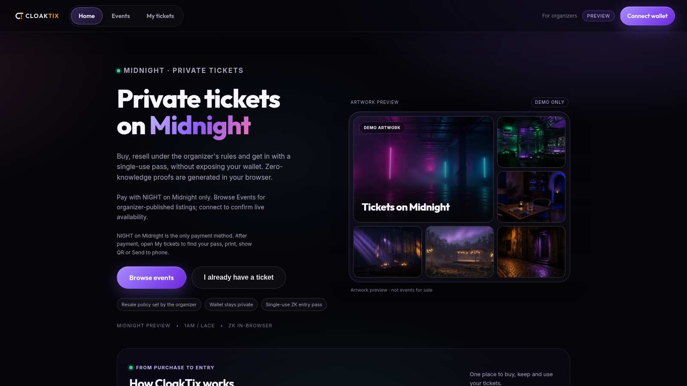
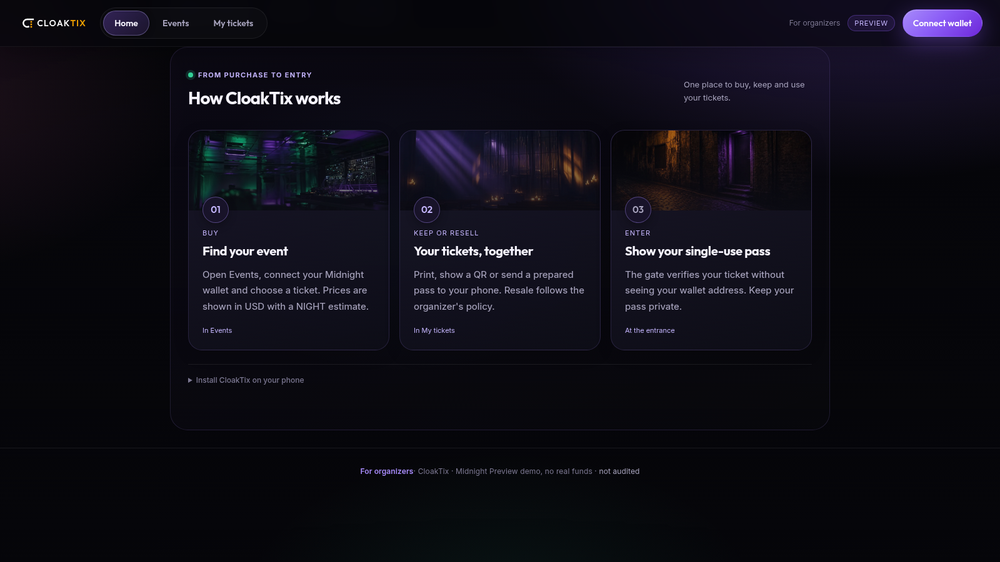
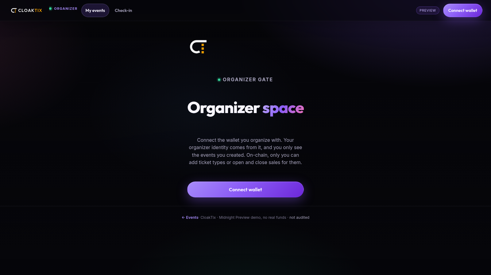

# CloakTix

Private event ticketing on Midnight Preview (ledger 9).

> **Status: prototype, not audited. Preview test network only. Do not use with real funds.**
> Built for the Midnight Buildathon, Wave 3.

CloakTix sells event tickets as tokens on Midnight. Buyers pay in **NIGHT only**. Prices are shown in **USD**, with a **NIGHT equivalent** underneath. The wallet is **1AM**. Fans buy with a zero-knowledge proof generated in the browser. At the door they turn one ticket into a single-use QR pass. Organizers set the resale rules for each ticket type. For 18+ types, buyers prove only "adult: yes". They do not show an ID document.

Thanks to the Midnight developer community and the [midnightntwrk](https://github.com/midnightntwrk) open-source work this project builds on, including Compact contracts, Midnight.js, ZKIR v3, and the Midnight Verifiable Credentials core (`midnightntwrk/midnight-verifiable-credentials`).

## Live Preview contracts

- Network: Midnight **Preview**, ledger 9
- **EGG-40 contract (current, public):** `7f6481e3bec6b778db7b5959837ab82a5ffe47468f56aab4bfc4bdc56830d372`.
  Source: `contract/cloaktix-egg40.compact`. Adds door keys and batch door settlement to the rate-v3 design.
  Signed USD quotes up to 300 s old.
- Earlier rate-v3 contract (schema 3, still readable): `b92733389b1955c913dec004df708a12697df4a962ffab5dbde1e88f574ab04e`
- Platform fee: 3% (`feeBps` = 300), sealed at deploy
- App (public): https://app.cloaktix.com
- Door relay (public, no secrets): `door-relay/`, a Cloudflare Worker
- Landing: https://cloaktix.com

The project owner deploys the contracts with 1AM. This repository does not sign transactions. The owner signs in 1AM.

## Launch Night demo

EGG-40 event 1 is **CloakTix Launch Night**: General admission (18+) and After party ticket types. Doors open
Dec 12, 2026, 19:00 to 23:00 (Toronto time). You can buy a ticket in the app with 1AM on Preview, open it in
My tickets, and show its QR at the door.

## Door check-in (EGG-40)

1. **Organizer sets doors** (for example Main door) and the door times in Organize event › Door keys.
2. **Staff phone, no wallet:** opens the door link, picks a door, and shows a pairing code. The phone keeps its
   own non-extractable signing key.
3. **Organizer approves** the phone after checking the fingerprint. This is one 1AM transaction
   (`authorizeDoorKey`) with a validity window of up to 48 h (the default is 1 h before doors until a day after).
   The app shows the steps: Building proof, then Approve in your wallet.
4. **Scan:** the phone reads the ticket on-chain (via the indexer) and asks the relay to record the first entry.
   The entry is signed by the door key. The ticket secret is encrypted to the organizer.
   Verdicts are Valid, Already used, Wrong door, Not for this event, Door not open yet (key window not started,
   nothing recorded), or Can't confirm entry (relay or indexer offline: fails closed).
5. **Settlement:** after the event, the organizer's settlement key (gate 99) records entries on-chain in
   batches of 4 (`admitByDoor4`). Plan B: the organizer can admit a guest directly with 1AM (`admit`).

The relay checks every write against the EGG-40 contract state read from the public indexer.
Organizer routes need an organizer signature bound on-chain.

## Features

- **Walletless catalog.** Anyone can browse organizer-published events without connecting a wallet. The catalog shows only real events with published ticket options, not metadata-key registration entries. Live prices, supply, and buying need a connected wallet.
- **Organizer event creation.** Name, date, place, description, and cover are required. The organizer sets a NIGHT payout address at creation. The form states that this address receives payments for the event and cannot be changed after creation. Organize event shows that address as a private, read-only record on the organizer's device.
- **NIGHT only.** USD list prices, with a NIGHT equivalent at the quoted rate. ADA payment is not offered.
- **Multi-ticket purchase in a single intent.** Buyers can buy more than one ticket of the same type at once (up to 4). All `buyTicket` calls are merged into one intent, in purchase order, so 1AM sees a single NIGHT input set. The purchase is all-or-nothing. This was confirmed live on Preview after an earlier error 227 (unshielded inputs not disjoint).
- **Demo 18+ age credential.** 18+ types use `buyTicketAdult`. A "Passport stub" test issuer, served by the Preview Worker at `/passport/issuer` and `/passport/issue`, signs a credential bound to the buyer's CloakTix identity. The contract checks the issuer signature and `adultFrom ≤ asOf`, and learns only "adult: yes". It never sees the birthdate. This is a demo issuer, not Midnight Passport. A later real issuer can be set with one `adminSet` transaction. No new contract is required.
- **Ticket type labels.** Each ticket shows its ticket type name (for example General admission), not only a type number.
- **My tickets.** Phone-first ticket cards in a two-column, square-ish grid (one column on very narrow screens). Actions include show QR, print, and send to phone. Connected and disconnected views use the same serial-ticket cards.
- **Send to phone.** A ticket can be opened on another phone from a local transfer link. The link travels in the URL fragment, which does not reach the server.
- **In-tab ZKIR v3 prover.** Compact 0.36.0 emits ZKIR v3. 1AM's built-in prover accepts v2, so CloakTix proves its own circuits in a tab worker (`zkir-v3` 3.2.0). 1AM still balances, pays DUST, and submits. Artifacts are cached and can be prewarmed when the buyer clicks Buy.
- **Resale policy per ticket type:** `capped` (default, price ≤ `maxResale`, enforced on-chain), `unlimited`, or `none`.
- **Single-use check-in.** Preparing a pass burns the ticket on-chain and records a nullifier. The Gate tab verifies the pass and refuses a replay.
- **Door-safe screen.** The app does not show wallet balances, because the phone may be shown at the door.
- **Same tickets on every device** when the identity is derived from the wallet, or moved with a transfer code. "My tickets" reads balances from the chain.


## Screenshots

Captured from the public Preview app on 10 November 2026:








## Architecture

| Layer | What |
|---|---|
| Contract | `contract/cloaktix-rate-v3.compact` (Compact 0.36.0, language 0.28.0): events, ticket types, NIGHT fee split, signed rate quotes, resale listings, 18+ check, check-in, pause, and issuer swap (`adminSet`) |
| Token base | OpenZeppelin Compact Contracts `MultiToken` and `Pausable` (commit `9b6b21a`). Account id = hash of the holder secret |
| Witnesses | `contract/witnesses-rate-v3.ts`: holder secret and optional age credential, from local private state |
| Web app | `web/`: React and Vite, Midnight.js 5.0.0, compact-runtime 0.21.0, DApp Connector v4 (1AM), on-chain runtime v4, ZKIR v3 |
| Preview Worker | `preview-worker/`: serves the app, public catalog, same-origin ZK assets and indexer proxy, and the demo Passport stub issuer |
| Door relay | `door-relay/` (code shared with `web/src/egg40/eventDoor.ts`): door keys, first-entry records, settlement queue; one Durable Object per event |
| Test issuer (local) | `web/passport-stub/server.mjs` can also issue credentials on a local port |

Doors and staff phones are live through the EGG-40 contract and the door relay (see Door check-in). The older schema 4 draft (`contract/cloaktix-rate-v4.compact`) is not deployed and stays fail-closed.

`buyTicketAda` / `buyTicketAdaAdult` exist on the v3 contract for an earlier multi-currency design. The product does not offer ADA.

## How to run

Proving keys, verifier keys, and `contract/zk-params` (about 24 MB) are **not** in this repository. They are large build artifacts. Compile them locally with the Compact 0.36.0 toolchain, or copy them in from a private build machine, before you can generate proofs or deploy.

```bash
# Web app dependencies and typecheck
cd web
npm install
npx tsc --noEmit

# Local Vite dev server (connect 1AM set to Midnight Preview)
npx vite
```

Demo age issuer for the Preview Worker:

```bash
cd preview-worker
cp passport-demo-key.example.js passport-demo-key.js
# Generate a Jubjub scalar and paste it into passport-demo-key.js.
# After npm install (so @midnight-ntwrk/compact-runtime is available):
node --input-type=module -e "import { newIssuerSecret } from '../contract/age-credential.mjs'; console.log(newIssuerSecret().toString(16))"
npm install
```

Do not commit `passport-demo-key.js`. A new issuer key will not match a contract already deployed with a different `ageIssuer`. The live Preview contract uses a private demo issuer already configured on the Worker. Do not rotate it unless you intend to sign `adminSet`.

Local Compact compile (optional, needs the Compact 0.36.0 toolchain):

```bash
# From the repo root
npm install
compact compile contract/cloaktix-rate-v3.compact contract/managed/cloaktix-rate-v3
```

Node unit tests for the web app (EGG-40 door flow included; a few tests skip because the live-state snapshots are not published):

```bash
cd web
node --experimental-strip-types --test test/egg4*.node.test.mts
```

Simulator tests (no network):

```bash
npm run test:sim
```

Preview web build (does not publish anything):

```bash
cd web
# Optional: cp .env.preview.example .env.preview
npm run build:preview
cd ../preview-worker
node sync-zk-assets.mjs
# Then, for a local worker only: wrangler dev --config wrangler.app.toml
```

Nothing in this README is an instruction to deploy, publish, or push. Publishing the live app or pushing to GitHub is a separate, explicit owner decision.

Local e2e against an undeployed devnet needs official Midnight genesis seeds. Those seeds are not stored here. Set `MIDNIGHT_LOCAL_ALICE_SEED` (and BOB, CHARLIE, DAVE) if you run those tests. Preprod/Preview funded-wallet tests need your own seed and API credentials in a gitignored env file. No keys are included in this repository.

## Known limits

- **Demo age issuer.** The Passport stub signs whatever birthdate is typed. It is not Midnight Passport and is not real age verification.
- **Door check-in** on the EGG-40 contract was tested live on Preview: staff phone approval, Valid, then Already used. On-chain batch settlement after a real event has not been run yet.
- **Resale is not end-to-end verified** on the ledger 9 contracts with 1AM. It is built and unit-tested.
- **Test scans count.** An entry recorded by a test door key before the event still marks that ticket used. Test with a spare ticket.
- **Payments are pseudonymous, not shielded.** Tickets are paid in unshielded NIGHT, which links the paying wallet address to the holder id. `checkIn` / admit reveal which holder id holds a ticket type.
- **Not audited.** This is a prototype.
- **Tickets do not appear in 1AM's NFTs tab.** They are MultiToken balances inside the contract. View them in CloakTix.
- **1AM shows more than one approval prompt per transaction** (balance, DUST, submit). In-tab proving for `buyTicket` takes on the order of 30 to 40 seconds on a typical machine, plus artifact download on a cold cache.
- **Wallet-derived identity** works only if the wallet's `signData` is deterministic. Otherwise the app falls back to a device key and a transfer code. Anyone who gets that signature or the transfer code controls the tickets.
- Event and ticket names live off-chain (catalog metadata, share link, local storage). A device that never opened the event may show a fallback name until it syncs.
- The fee address is a public unshielded address. It is hidden in the UI but visible on-chain.
- Gate replay protection is per gate device. The on-chain burn still limits each ticket to one pass.
- The 18+ credential is bound to the holder id, but it cannot stop someone from handing over their key. Revocation is not supported yet.
- Some on-chain leftovers on the live contract (a typeless key-registration entry, and two identical General admission types) cannot be deleted. The buyer UI hides the typeless entry and collapses exact duplicate types. Removing them on-chain would need a new contract, which is not planned.

## Repository layout

```
contract/           Compact sources (incl. cloaktix-egg40.compact) and compiled JS / ZKIR (no proving keys)
door-relay/         Cloudflare Worker for door entries (EGG-40)
web/                React app, tests, static assets
preview-worker/     Cloudflare Worker for app.cloaktix.com
coming-soon/        Public cloaktix.com landing
slides/             Wave 3 deck (HTML + PDF)
docs/screenshots/   Public app screenshots (10 November 2026)
e2e/  test/         Simulator and end-to-end tests
brand/              Logo and brand kit (please do not modify the logo)
```

## License and credits

Apache-2.0: see `LICENSE` and `NOTICE`. Copyright 2026 P-Jay G.

Built on **OpenZeppelin Compact Contracts** (`MultiToken`, `Pausable`; MIT, © Zeppelin Group Ltd). Credential format follows the Midnight Verifiable Credentials core (`midnightntwrk/midnight-verifiable-credentials`).
